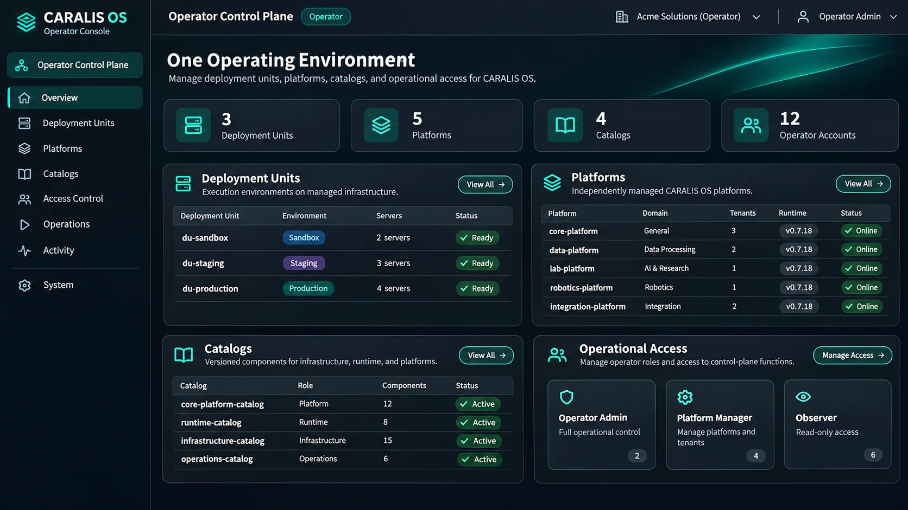
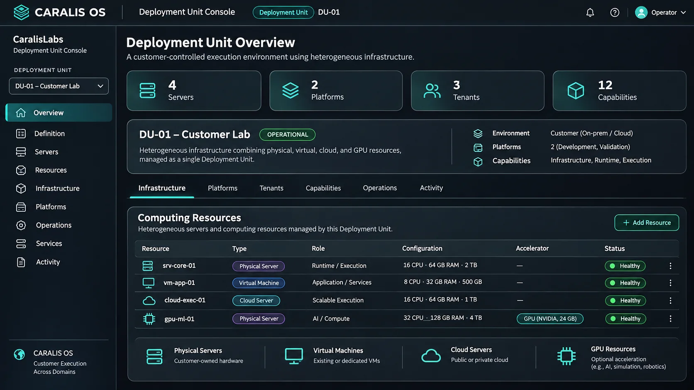
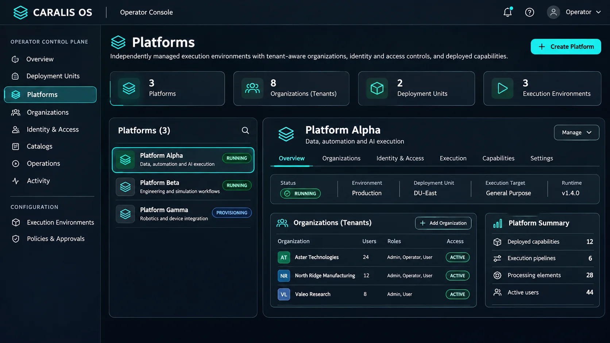
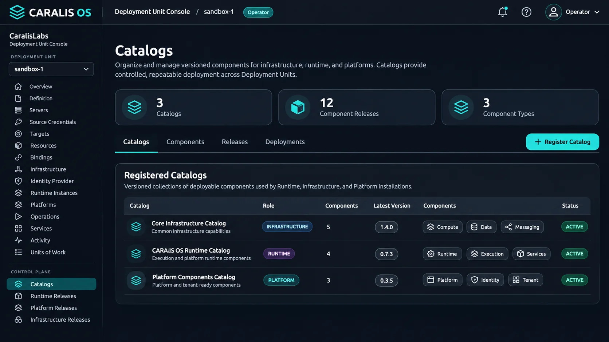

# TF-RFC-0024 — Deployment Units and the CARALIS OS Operating Model

**RFC ID:** TF-RFC-0024  
**Status:** Public Architectural Disclosure  
**Publisher:** Caralis Inc. (CaralisLabs)  
**Year:** 2026  
**Scope:** Deployment Units, Platforms, Infrastructure,
Component Catalogs, Lifecycle Operations, and Operator UX

**Copyright © 2026 Caralis Inc. All rights reserved.**

This document describes the CARALIS OS Deployment Unit
operating model and its associated architectural concepts.

It is published to establish an attributable record of
the architecture, terminology, relationships, and
illustrative user experience developed by CaralisLabs.

This publication is subject to the applicable notices
in [LEGAL.md](../LEGAL.md).
## 1. Purpose and scope

CARALIS OS uses **Deployment Units (DUs)** as managed deployment and operational boundaries for infrastructure and CARALIS OS Platforms. The operating model distinguishes an Operator-side control plane from the runtime environments deployed into DUs. This document captures the high-level relationships and intended operator experience without disclosing credentials, internal endpoints, infrastructure identifiers, deployment manifests, or confidential control protocols.

This document is not a specification for a universally novel concept. It records the particular terminology, organization, and design direction used by CaralisLabs, subject to verification against historical implementation evidence.

## 2. Architectural relationships

```text
CARALIS OS Operator / Operator Control Plane
    └── manages Deployment Units
          ├── compatible infrastructure resources
          │     (physical / virtual / cloud / hybrid, subject to support)
          ├── deployment and lifecycle operations
          ├── versioned component catalogs and requirements
          └── one or more CARALIS OS Platforms
                ├── Platform Runtime services
                ├── eligible tenant organizations and users
                └── governed execution capabilities
                      ├── Processing Elements (PEs)
                      └── PER pipelines
```

The diagram is conceptual, not a network topology or security boundary specification. A DU is not the same as a tenant or a Platform. A Platform is a distinct runtime context, while tenant associations and authorization determine eligible access. The Operator control plane is distinct from deployed runtime services.

## 3. Deployment Units

A Deployment Unit provides an operational scope in which compatible infrastructure resources can be provisioned or adopted and used to deploy and operate CARALIS OS components. A DU may contain heterogeneous resources; specific compatibility, trust, connectivity, and resource requirements are determined by the actual deployment contracts and implementation.

The DU model is intended to make infrastructure ownership and control explicit rather than assuming that execution must take place in a single vendor-managed cloud. This is an architectural goal, not a claim that every infrastructure type is currently supported.

## 4. Platforms and tenant organizations

A DU may host multiple independently managed CARALIS OS Platforms. Each Platform has its own identity and runtime context. Tenant organizations may be associated with eligible Platforms; access remains subject to identity, authorization, and operational configuration. Neither a DU nor a Platform should be equated with a tenant organization.

## 5. Catalogs, deployment, and operations

Versioned components and their declarative requirements inform deployment planning and lifecycle operations. Operational interfaces can expose infrastructure resources, Platforms, component catalogs, and operation status. This document does not claim that every illustrated metric, control, or status is implemented or that end-to-end deployment is validated for every scenario.

## 6. Governed execution relationship

Platform Runtimes are intended to support execution using reusable Processing Elements and composed PER pipelines, with governance and operational evidence as architectural concerns. The DU model establishes where runtime components are deployed and operated; it is not itself a replacement for execution-time authorization or policy controls.

## 7. Illustrative operator experience

The following visuals are **redesigned illustrations**, not sanitized copies of production screenshots. Their example names, counts, statuses, and controls are fictional or illustrative. They are included to record a UX direction, not to certify available functionality.

### Operator Console


### Deployment Unit overview


### Platform management


### Component catalogs


The underlying product UI may evolve independently of these images.

## 8. Provenance and Intellectual Property

### 8.1 Research and development provenance

This RFC forms part of the ongoing research and development undertaken by Nicolae Dumitru Caralicea and CaralisLabs in distributed execution infrastructure, governed execution, Platform Runtimes, Deployment Units, and execution governance.

The architectural model described here builds upon earlier work documented in the TextFind research portfolio, including:

- **TF-RFC-0008 — Governable Execution Infrastructure**
- **TF-RFC-0018 — Governed Execution Platforms**
- **TF-RFC-0019 — Federated Execution Operator Ecosystems**
- **TF-RFC-0020 — Domain Capabilities and Portable Governed Execution**

The repository's historical commits, RFC revisions, architectural documentation, and implementation records provide supporting evidence of the evolution of this work. This RFC records the Deployment Unit operating model and associated illustrative user experience as publicly disclosed in this revision; it does not assign an invention date to every element described.

### 8.2 Intellectual property and ownership

The architectural descriptions, documentation, and original expressive elements in this RFC are subject to the applicable intellectual property rights and licensing terms of their respective rights holders.

CARALIS OS software, proprietary implementations, internal deployment mechanisms, and confidential operational technologies remain separately governed by their applicable licenses and agreements.

The interface images are **AI-assisted, illustrative design previews**, not production screenshots or evidence that every depicted feature is implemented. Actual interfaces may evolve. Rights in AI-assisted material depend on applicable law and the circumstances of creation.

Publication establishes an attributable public record of the material disclosed. It does not, by itself, create exclusive rights over general architectural ideas, terminology, methods, or independently developed implementations.

### 8.3 Applicable legal terms

This RFC is subject to the applicable provisions of the repository's [LEGAL.md](../LEGAL.md), including its provisions concerning public disclosures, intellectual property, prior art, licensing history, and proprietary implementations.

Copyright © 2026 Caralis Inc. All rights reserved, subject to applicable prior licenses and third-party rights.