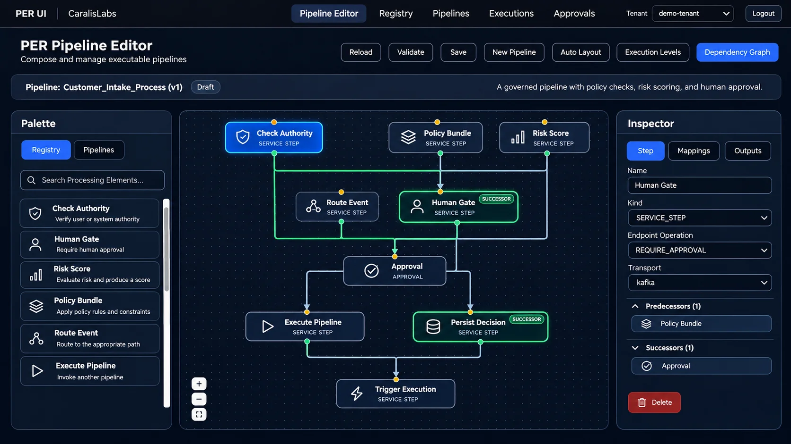
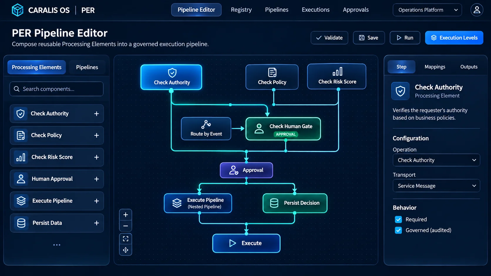
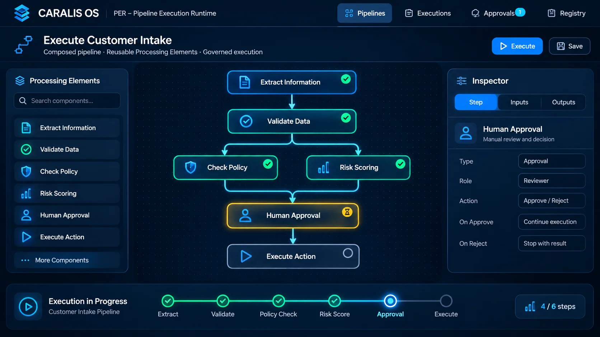
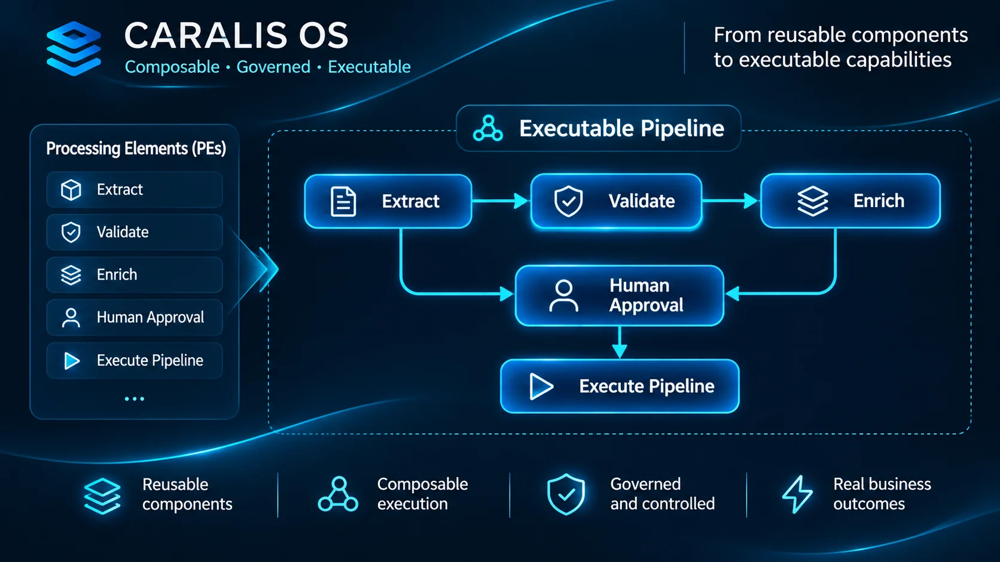

# PER — Processing Elements, Pipelines, and Governed Execution

**RFC ID:** To be assigned  
**Status:** Public Architectural Disclosure  
**Publisher:** Caralis Inc. (CaralisLabs)  
**Year:** 2026  
**Scope:** Pipeline Execution Runtime (PER), Processing Elements, Pipeline Composition, Execution, Governance, and PER UX

**Copyright © 2026 Caralis Inc. All rights reserved.**

This document describes the PER execution model and its relationship to CARALIS OS. It records the terminology, architectural relationships, and illustrative user experience developed by CaralisLabs. It is intended as a high-level public disclosure, not a developer manual or implementation specification.

This publication is subject to the applicable notices in [LEGAL.md](../LEGAL.md).

## 1. Purpose and scope

**PER (Pipeline Execution Runtime)** is the execution foundation used to run composed Pipelines built from reusable **Processing Elements (PEs)**. A Pipeline defines executable work and its relationships; PER coordinates the execution of that definition and makes execution state and results available for inspection.

PER is not synonymous with CARALIS OS. CARALIS OS provides the broader operating model for Deployment Units, Platforms, runtime services, identity, governance, and lifecycle operations. PER operates within that broader environment.

This document records CaralisLabs' particular design and terminology. It does not claim that general ideas such as workflow graphs, reusable components, or human approvals are universally novel.

## 2. Architectural relationships

```text
CARALIS OS Operator / Operator Control Plane
    └── manages Deployment Units
          └── one or more CARALIS OS Platforms
                ├── Platform Runtime services
                │     └── PER (Pipeline Execution Runtime)
                ├── deployed Processing Elements (PEs)
                └── deployed Pipeline definitions
                      ├── PE execution steps
                      ├── dependencies and data mappings
                      ├── human participation where required
                      └── nested Pipeline invocation
```

The diagram is conceptual. A **Platform** comprises its Runtime and any PEs and Pipelines deployed to it; a newly provisioned Platform may initially have no application-specific PEs or Pipelines. PER is part of the execution foundation, not a substitute for the surrounding Platform or Deployment Unit operating model.

## 3. Processing Elements

A **Processing Element** encapsulates an executable operation that can be reused in different Pipelines. Depending on its purpose, a PE may implement domain logic, transform data, integrate with another service, or perform a specialized processing task.

The model separates reusable operations from the Pipelines that compose them. A PE is not necessarily an AI model or an autonomous agent; deterministic and conventional software operations are equally relevant.

## 4. Pipelines and composition

A **Pipeline** defines a graph of execution steps, including dependencies and the relationships between inputs and outputs. Pipelines may combine multiple PEs and may invoke other Pipelines, allowing reusable compositions to be built at different levels.

The Pipeline Editor illustrates the authoring experience: selecting registered components, arranging execution steps, and inspecting step configuration and mappings. The exact supported operations and runtime semantics are determined by the implementation and its verified behavior.

## 5. Execution and governance

PER is responsible for coordinating Pipeline execution and exposing information about execution progress, outcomes, and relevant traces or artifacts. The broader CARALIS OS architecture addresses authorization, policies, and operational controls; individual Pipelines may also include explicit approval or decision steps.

A visible approval step in a Pipeline is not, by itself, proof that every authorization or policy guarantee is enforced across all deployment configurations. Such guarantees depend on the implemented and validated integration of the relevant services.

## 6. Relationship to executable capabilities

Reusable PEs and Pipelines provide a foundation for constructing domain-specific executable capabilities. Different contributors may participate by developing PEs, composing Pipelines, creating applications, testing integrations, or operating the infrastructure on which Platforms run.

Participation, ownership, licensing, compensation, and any commercial terms are governed by separate agreements. Publishing a capability concept does not imply that a public marketplace, self-service distribution, or revenue-sharing mechanism is already operational.

## 7. Illustrative PER experience

The following visuals are **AI-assisted redesigned illustrations**, inspired by PER development interfaces. They are **not authentic application screenshots**, and the names, statuses, graph connections, configuration controls, and execution outcomes shown are illustrative. They record a design direction and help communicate the concepts; they do not certify end-to-end functionality or production readiness.

### Pipeline authoring



### Pipeline composition



### Governed execution



### Composable execution overview



The underlying product UI and architecture may evolve independently of these illustrations.

## 8. Provenance and intellectual property

### 8.1 Research and development provenance

This disclosure forms part of the ongoing research and development undertaken by Nicolae Dumitru Caralicea and CaralisLabs in Processing Elements, Pipeline Execution Runtime, composable execution, distributed systems, and governed execution.

Related public work in the TextFind research portfolio includes:

- **TF-RFC-0008 — Governable Execution Infrastructure**
- **TF-RFC-0018 — Governed Execution Platforms**
- **TF-RFC-0019 — Federated Execution Operator Ecosystems**
- **TF-RFC-0020 — Domain Capabilities and Portable Governed Execution**
- **TF-RFC-0024 — Deployment Units and the CARALIS OS Operating Model**

The repository's historical commits, RFC revisions, and other dated implementation records provide supporting evidence of how the work evolved. This publication records the material disclosed in this revision; it does not assign an invention date to every component or idea.

### 8.2 Intellectual property and ownership

The architectural descriptions, documentation, and original expressive elements in this document are subject to the applicable intellectual property rights and licensing terms of their respective rights holders.

CARALIS OS and PER software, proprietary implementations, internal execution mechanisms, and confidential operational technologies remain separately governed by their applicable licenses and agreements.

The interface images are **AI-assisted illustrative design previews**, not production screenshots or evidence that every depicted feature is implemented. Rights in AI-assisted material depend on applicable law and the circumstances of creation.

Publication establishes an attributable public record of the material disclosed. It does not, by itself, create exclusive rights over general architectural ideas, terminology, methods, or independently developed implementations.

### 8.3 Applicable legal terms

This document is subject to the applicable provisions of the repository's [LEGAL.md](../LEGAL.md), including its provisions concerning public disclosures, intellectual property, prior art, licensing history, and proprietary implementations.

Copyright © 2026 Caralis Inc. All rights reserved, subject to applicable prior licenses and third-party rights.
